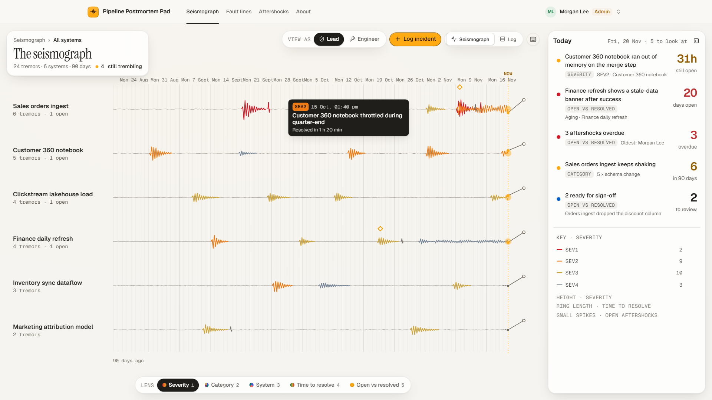

# Pipeline Postmortem Pad

A two-minute form for logging a pipeline or notebook failure, a gentle nudge toward blameless wording, and trend charts
that show which causes keep coming back. Data engineers log and edit incidents, leads review them, and everyone signed in
can read them. It is a Microsoft Fabric App (preview): a React front end on Fabric static hosting, a Fabric SQL database
with a generated GraphQL API, and Fabric (Microsoft Entra ID) sign-in.



## What it looks like

**The seismograph.** Every incident of the last 90 days is a tremor on its system's trace: it starts where the failure
started, its height is the severity, its ring-down is the time to resolve, and an open incident keeps trembling up to the
stylus at "now"; small spikes after a tremor are its open action items (red when overdue). Each incident opens as a
**black box**, a flight-recorder timeline (started → detected → resolved, with the time between each mark) beside a
transcript where the blameless prompt sits next to the exact words it flags.

- **Lenses** (keys 1–5): severity, category, system, time to resolve, open vs resolved. **View as** lead or engineer
  (key V): the lead view marks incidents ready for sign-off; the engineer view dims what is not yours.
- **Today**: the most severe open incident, the oldest aging one, overdue aftershocks (yours, as an engineer), the
  noisiest system and the sign-off queue; each one focuses the drum and switches to the lens that explains it.
- **Tools**: **Fault lines** (weekday × hour fault map, recurring causes, recovery time per month, the systems that
  shake most, each with its own trace), **Black box** (incident timeline and transcript), **Aftershocks** (open action
  items by owner on a due-date strip, overdue first, tick with undo).
- **Fallbacks**: the **Log** toggle (key L) shows the same incidents as a filterable table (a divided list on phones);
  the drum is SVG, so it needs no WebGL (`?nowebgl` draws the same), and reduced motion stops the trembling and the
  draw-in. `?` lists every shortcut. Screenshots of every screen, light and dark, desktop and phone: `docs/redesign/`.

Demo video (about 2 minutes, AI-generated narration, captions burned in): [demo/out/postmortem-pad.mp4](demo/out/postmortem-pad.mp4) · captions file [demo/out/postmortem-pad.srt](demo/out/postmortem-pad.srt). Re-record with `npx tsx tools/demo/record.ts postmortem-pad` from the repo root.

## 1. Prerequisites

- The **Fabric Apps** workload enabled for your tenant (preview), and a Fabric workspace on a capacity.
- **Edit** (Contributor or higher) permission on that workspace to deploy.
- Node.js 20 or later.
- Users need access to the app item. Workspace members have it by default; others must be granted access.
- No connectors, no anonymous access, no extra tenant settings.

## 2. Run locally

```bash
npm install            # once, at the repo root
cd apps/postmortem-pad
npm run dev            # offline demo on http://localhost:5205 with seed data and a persona switcher
npm run dev:fabric     # rayfin dev: the real Rayfin backend with Fabric sign-in
```

Demo mode keeps data in your browser (localStorage). Use the identity menu to switch between **Morgan Lee** (lead),
**Priya Nair** and **Sam Taylor** (engineers), or to reset the demo data. `?as=demo-sam` opens the app as a persona.

Tests: `npx tsc -b`, `npx vitest run`, `npx vite build --mode demo`, `npx playwright test` (390 px and 1280 px).

## 3. Deploy

```bash
npx rayfin login
npx rayfin up --workspace-id <workspace-id>
npx rayfin up status
```

`rayfin up` builds the app (`build:fabric`), uploads it, and applies schema changes (new tables or columns) in the same step.

## 4. Seed

```bash
node tools/seed-fabric.mjs --app postmortem-pad --admin-email you@org.com   # from the repo root
# or, from apps/postmortem-pad: npm run seed:fabric -- --admin-email you@org.com
```

Inserts the same fictional rows as demo mode: 30 incidents over the last 120 days across 6 made-up systems, and 12
action items (some done, three overdue, one with no due date). Patterns to look for: "Sales orders ingest" has 9 incidents,
6 of them schema changes; 14 incidents start on a Monday between 07:00 and 10:00. Open incidents include two that are
"aging" (open over 7 days). It is idempotent (marker row `seed:v1`) and never runs automatically. Open the app once first
so your Person row exists. The `--admin-email` flag maps the first demo persona (Morgan Lee, the lead) to you: you
become the real admin (lead), and seed rows owned by the lead persona stand in for your team's history. The two engineer
personas stay as fictional seed authors. The manual way to make someone a lead:

```sql
UPDATE dbo.People SET isAdmin = 1 WHERE email = 'you@yourorg.com';
```

## 5. How it works

| Entity | Fields | Notes |
|---|---|---|
| `Incident` | title (5–120), system (2–100), severity (`sev1`–`sev4`), category (8 values), startedAt, detectedAt?, resolvedAt?, summary?, rootCause?, fix?, prevention? (each ≤ 1000), status (`open`, `resolved`, `reviewed`), reporterSub, reporterName, createdAt | Table `dbo.Incidents` |
| `ActionItem` | incidentId, title (3–150), ownerName (1–100), dueDate?, done, createdBySub, createdAt | Plain id column to the incident |
| `Person` | sub, displayName, email, isAdmin | Shared identity row; `isAdmin` = lead |
| `AppMarker` | key | Seed marker |

Screens: **Seismograph** (home; the **Log** view filters by severity, category, system, status and date range),
**Log an incident** (quick form plus "Add details now", with a live preview of the tremor), **Black box** (incident
timeline with durations, transcript with blameless prompts, its system's trace, action items), **Fault lines** (last 90
days by default), **Aftershocks** (open items by owner, overdue first), **About**.

Rules (`src/domain/rules.ts`, thresholds and wording in `src/config.ts`):

1. The quick form needs only title, system, severity, category and start time (defaults to now).
2. Status resolved (or reviewed) needs a resolved time, a root cause and a fix. Detected and resolved times cannot be
   earlier than the start; a start time in the future is rejected.
3. Only a lead (`Person.isAdmin`) can mark an incident reviewed, only when it is resolved and has at least one action item.
   A reviewed incident is a signed-off record: only a lead can edit or reopen it. Engineers can still tick off its
   action items.
4. Time to detect = detectedAt − startedAt, time to resolve = resolvedAt − startedAt, in minutes from UTC milliseconds
   (daylight-saving changes cannot skew them). An action item is overdue once its due day has passed and it is not done.
   An open incident older than 7 days gets an "Aging" chip.
5. Blameless nudge: words such as "forgot to", "careless", "stupid", "lazy", "fault" or "blame" in summary, root cause,
   fix or prevention show a polite inline tip (`role="status"`) with a rewording idea. It never blocks saving.
6. Choosing a category pre-fills a short checklist into root cause (only when it is empty or still holds the previous
   untouched checklist). An untouched checklist is never saved and does not count as a root cause.

Deliberate deviations from the spec (stricter on purpose):

- Rule 2 in the spec asks for a root cause and a fix to resolve; this app also requires the **resolved time**, so time to
  resolve is never missing for a resolved incident and the Fault lines recovery chart stays complete.
- Rule 3 in the spec only requires an action item before review; this app also requires the incident to be **resolved**
  first, so a review always covers a finished postmortem (root cause and fix written).
- A reviewed incident is locked for engineers (rule 3 above); the spec does not say what happens after review.

Fault lines: incidents by category (with a data table for checking), median time to resolve per UTC month, top 5 systems
(names grouped ignoring case and extra spaces, shown in their most common spelling),
and a weekday × hour heatmap of start times in the viewer's local time. A short range shows empty charts.

### Security model

| Entity | Read | Create | Update | Delete |
|---|---|---|---|---|
| Incident | any signed-in user | only as yourself: `claims.sub == reporterSub` | any signed-in user; `reporterSub`, `reporterName`, `createdAt` excluded | nobody |
| ActionItem | any signed-in user | only as yourself: `claims.sub == createdBySub` | any signed-in user; `incidentId`, `createdBySub`, `createdAt` excluded | nobody |
| Person | any signed-in user | own row, `isAdmin` excluded | own row, `isAdmin` and `sub` excluded | nobody |
| AppMarker | any signed-in user | nobody (seeded with SQL) | nobody | nobody |

Why updates are open to every signed-in engineer: an incident is a shared team record. The person who logs a failure at
02:00 is often not the person who finds the root cause or writes the fix, so any engineer can complete the story and
tick off follow-ups. Once a lead marks it reviewed it is locked for engineers in the app. The policies still stop anyone from impersonating a reporter, rewriting who reported an incident,
moving an action item to another incident, or deleting history.

Enforced in the domain functions (`src/domain/incidents.ts`), in demo mode and in Fabric: all validation and status
rules above, including the lead-only review and the lead-only editing of reviewed incidents.

## 6. VERIFY outcomes and known limits

- VERIFY outcomes for the platform are in `shared/NOTES.md` (numbers, `@set` enums, polling, charts, claims). This app uses
  `@set` for severity, category and status, `@date` for all timestamps, and no `@int` columns (durations are derived).
- Deployed to a Fabric workspace on 20 Nov 2026: `rayfin up` applied the schema with every row policy above accepted.
- **Known limit: "reviewed" and its lock are lead-only in the app, not in the database.** In the UI, only a lead can mark
  an incident reviewed, and engineers cannot edit or reopen a reviewed incident (the domain functions refuse it in demo
  mode and in Fabric). There is no admin claim, so the row policy cannot tell a lead from an engineer: a signed-in user
  calling the GraphQL API directly could still set `status = 'reviewed'` or edit a reviewed incident's fields. Closing this needs dynamic auth claims (`udf.authClaims`) or a Function that owns
  the status change (see Later).
- Known limit: validation (lengths beyond the decorators, time ordering, "resolved needs root cause and fix") runs in the
  app. The database enforces column lengths and enum values only.
- Known limit: incidents and action items cannot be deleted from the app. A mistaken row can be removed with SQL by the
  deployer.
- Known limit: the Fabric build embeds the Rayfin API URL (which contains the tenant and workspace ids) and the
  publishable key (`pk-…`) in the JavaScript bundle. Neither is a secret: the key only identifies the app, and every
  request still needs a Fabric sign-in and passes the row policies. Nothing in this repo contains them.
- Owner names on action items are free text (with suggestions), so "Priya" and "Priya Nair" are separate owners.
- Lists load all rows (paged by the shared store). That is fine for thousands of incidents; beyond that, add date filters
  on the server.

## 7. Later

- A Fabric Function that creates an incident from a failed pipeline run.
- Weekly digest of new incidents and overdue action items.
- Database-level enforcement of the lead-only review (dynamic auth claims or a Function).
- Export of an incident as Markdown for a wiki.

## 8. Gallery

- **Title:** 12 Days of Fabric Apps: Day [#] – [Theme]: Pipeline Postmortem Pad
- **Blurb (≤ 80 words):** Your pipeline failures on a seismograph. Every incident is a tremor on its system's trace:
  height is severity, the ring is time to resolve, and open ones keep trembling. Each opens as a black box with the
  timeline and a blameless prompt beside the words it flags. Fault lines shows the causes that keep coming back and
  when failures start; Aftershocks tracks every follow-up. A five-field form logs it in two minutes. Fabric SQL and
  Entra ID sign-in.
- **Tags:** Partner | 12 Days of Fabric Apps, Data Engineering, Pipelines, Incident Management, Fabric SQL
